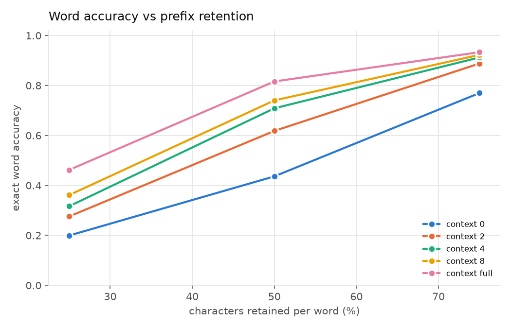
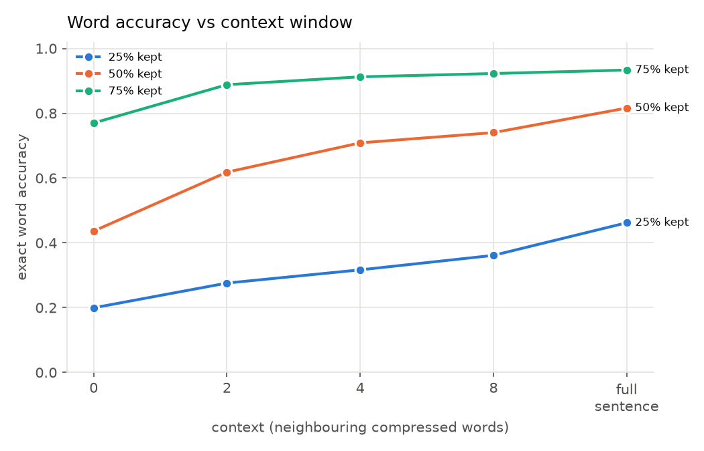
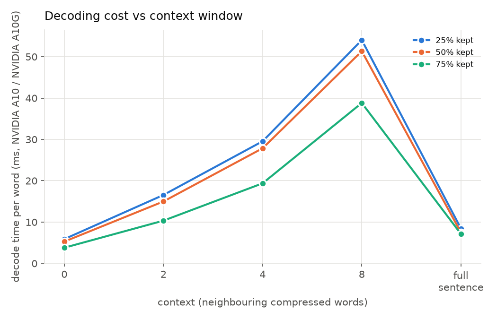
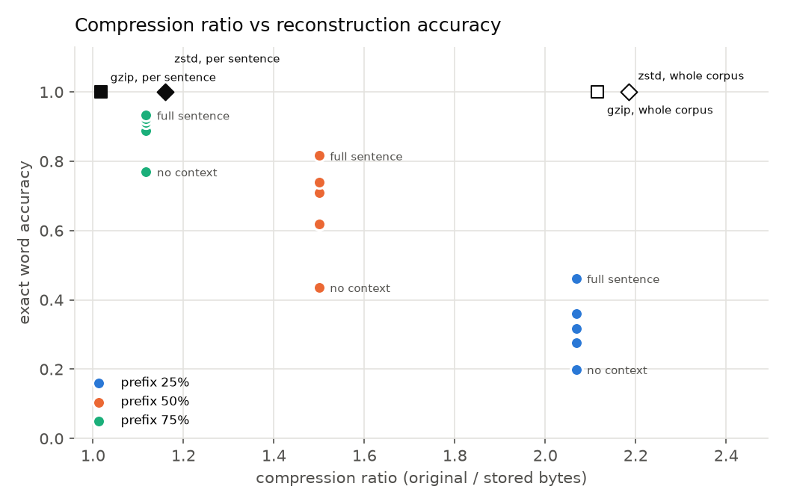
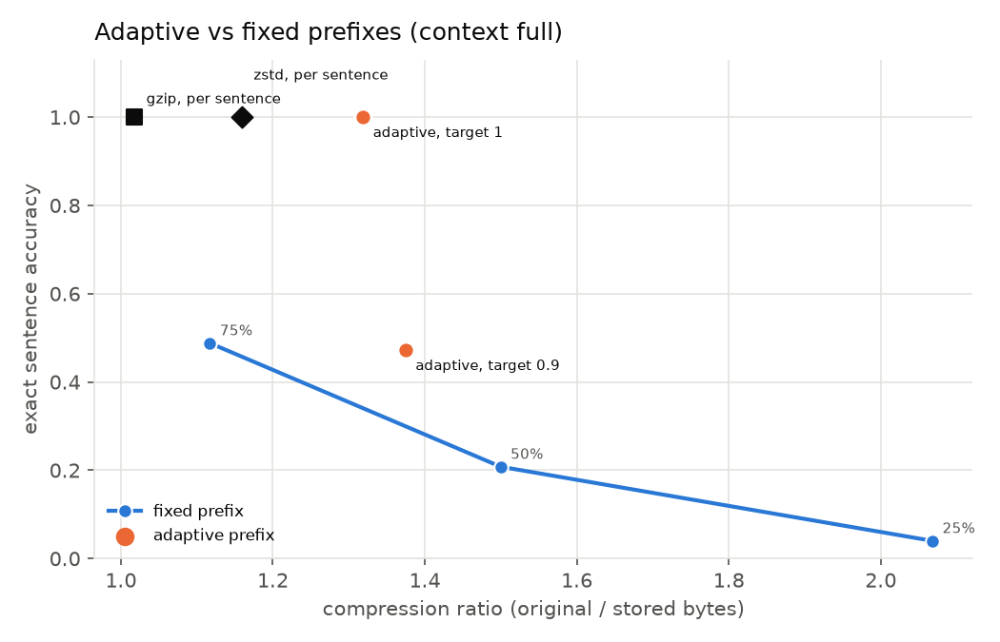

# neural_compression: prefix-based lossy text compression with a small LM

A research prototype that asks:

> How much of each word can we delete and still have a small pretrained
> language model put it back, and how do context and compute affect that?

The compressor keeps only the first part of every word. The decompressor asks
a small pretrained language model to fill in the rest. **The scheme is lossy**:
the output can differ from the input, and the benchmark measures how often.

```
original      The programmer discovered an unexpected problem in the application.
stored (50%)  Th progr disco a unexp prob i th applic.          (43 bytes incl. 3-byte header, vs 67)
restored      The programmer discovered an unexpected problem in the application.
```

## Results

125 English sentences in 5 categories (25 each, `data/benchmark.jsonl`),
SmolLM2-360M, beam 4, run on Modal (NVIDIA A10/A10G). Full tables are in
`results/summary.csv`, `results/summary_by_category.csv`, and per-sentence
outputs in `results/rows.csv`.

### Accuracy vs retention and context (word accuracy / exact-sentence accuracy)

| kept per word | ratio* | no context (A) | ±1 word (B2) | ±2 (B4) | ±4 (B8) | full sentence (C) |
|---|---|---|---|---|---|---|
| 25% | 2.07 | 19.9% / 0% | 27.6% / 0% | 31.7% / 0% | 36.1% / 0.8% | **46.2% / 4.0%** |
| 50% | 1.50 | 43.6% / 0% | 61.8% / 0.8% | 70.9% / 8.0% | 74.0% / 12.8% | **81.6% / 20.8%** |
| 75% | 1.12 | 77.0% / 5.6% | 88.8% / 27.2% | 91.2% / 34.4% | 92.3% / 36.8% | **93.3% / 48.8%** |

\*original bytes / stored payload bytes, per sentence, header included. The
same payload serves every context setting. Character error rate at 50%: 20.1%
with no context, 6.8% with full context.




**Context matters a lot.** At 50% retention, going from no context to the full
sentence nearly doubles word accuracy (44% → 82%). More neighbours always
helped. Full-sentence decoding beats an 8-word window too, partly because it
also conditions on the already *restored* words to the left.

### Cost of context



| context | 0 | 2 | 4 | 8 | full |
|---|---|---|---|---|---|
| ms per word (A10, 50%) | 5.3 | 15.0 | 27.9 | 51.3 | **7.5** |
| decoder requests (all 125 sentences) | 2005 | 2005 | 2005 | 2005 | **140** |

The windowed strategies issue one request per truncated word, and each
request regenerates its whole window. So their cost grows with the window,
while full-sentence decoding issues one request per sentence. **Here the
most accurate strategy is also nearly the cheapest.** On a laptop CPU (Ryzen 7
7730U) full-sentence decoding ran at ≈100 ms per word.

### Compression vs accuracy, against lossless baselines



| method (all 125 sentences) | per-sentence files | one corpus file | word acc. | exact sentences |
|---|---|---|---|---|
| gzip -9 (lossless) | 1.02 | 2.12 | 100% | 100% |
| zstd -19 (lossless) | 1.16 | 2.18 | 100% | 100% |
| prefix 75% (+ zstd on corpus) | 1.12 | 2.42 | 93.3% | 48.8% |
| prefix 50% (+ zstd on corpus) | 1.50 | 3.12 | 81.6% | 20.8% |
| prefix 25% (+ zstd on corpus) | 2.07 | 4.26 | 46.2% | 4.0% |
| **adaptive, target 100%** (+ zstd on corpus) | **1.32** | **2.52** | **100%** | **100%** |
| adaptive, target 90% (+ zstd on corpus) | 1.37 | 2.65 | 95.9% | 47.2% |

(Ratios are original / stored bytes. All prefix rows use full-sentence context.
Model weights, 1.45 GB, are **not** counted. The corpus columns zstd-compress
the whole prefix payload as one file.)

**Fixed prefixes do not beat lossless compression in any useful sense.** The
only settings that beat zstd's 2.18 on the corpus still get 7–54% of words
wrong. That is lossy compression with silent, plausible-looking errors.

### Adaptive prefixes



Adaptive prefixes move the trade-off a long way. With target 100%,
**every one of the 125 sentences is reconstructed exactly**. A separate fresh
decode of the final payload confirmed all 125. The compressor needed 5.3
rounds on average (max 9, i.e. some words were escalated to full storage). The
result is smaller than zstd both per sentence (1.32 vs 1.16) and as a corpus
(4,990 vs 5,753 bytes, −13%). Fixed 75% is both larger *and* less accurate
than adaptive at 90%.

So the system becomes a **lossless** compressor, with conditions: receivers
must share the exact model, revision, and decoder settings, compression costs
several decoder runs per sentence, and decoding is ~10⁴× slower than zstd. It is also far from
what the same model could achieve with arithmetic coding over its next-token
probabilities, the standard way to turn an LM into a compressor. Truncating
words throws away the model's probabilities and keeps only "which prefix was
enough".

**Cross-device check.** The 125 adaptive payloads were tuned on an NVIDIA A10.
Merged into one 4,990-byte corpus file, they were decoded again on a laptop
CPU (`scripts/verify_corpus.py`) and came back **byte-identical: 2,056/2,056
words, every separator** (`results/verify_adaptive@1_cpu.json`). This is
evidence, not a guarantee: a near-tie in beam search could still flip on some
other hardware.

### By category (full-sentence context)

| category | 50%: word / sentence | 75%: word / sentence | adaptive 100%: ratio |
|---|---|---|---|
| conversational | 90.1% / 48% | 97.7% / 84% | 1.40 |
| technical docs | 75.2% / 4% | 92.2% / 36% | 1.25 |
| scientific | 83.3% / 8% | 94.9% / 44% | 1.35 |
| names & numbers | 79.9% / 12% | 90.8% / 28% | 1.32 |
| ambiguous prefixes | 80.3% / 32% | 91.5% / 52% | 1.28 |

Everyday language is easiest. Technical documentation (identifiers,
`TensorFlow`, `DETR`, `panoptic`) and names are hardest. The adaptive ratio
shows the same thing: hard text needs longer prefixes.

### What the errors look like (50%, full context)

| original | restored | kind |
|---|---|---|
| Gazi Ashraf Hossain Lipu | Gary Ashlee Hossley Lien | names → common names |
| TensorFlow, JAX, compiler | TensoiOpt, JAMA, company | jargon → non-words / wrong words |
| Monte Carlo gradient | Monday Carola graduate | rare phrase → frequent words |
| initialization, panoptic | initialeonnen, panother | hallucinated non-words |
| be, Dr, GO | b, D, G | copy bias: prefix echoed as a complete word |
| concrete, patent | concert, patie | shared-prefix ambiguity |

## Quick start

```bash
uv sync                                   # Python 3.12, CPU-only PyTorch
uv run pytest                             # unit + decoder-guarantee tests (~10 s)

echo "The programmer discovered an unexpected problem in the application." > input.txt
uv run python -m neural_compression compress input.txt --retention 0.5          # -> input.bin
uv run python -m neural_compression decompress input.bin --context full
uv run python -m neural_compression decompress input.bin --context 4
uv run python -m neural_compression compress input.txt --adaptive --target 1.0  # verified by the real decoder

uv run python -m neural_compression benchmark --dataset data/benchmark.jsonl --out results
uv run python -m neural_compression plot --results results     # redraw charts
```

The first model call downloads `HuggingFaceTB/SmolLM2-360M` (~720 MB, pinned
revision) into the Hugging Face cache. A plain `.txt` file with one sample per
line also works as `--dataset`. Use `--device cuda` / `--batch-size 64` on a GPU.

**On Modal GPUs** (each configuration runs in its own container, in parallel;
finished configurations are cached in `results/_parts/`, so reruns resume):

```bash
uv run --with modal modal run scripts/modal_app.py --out results
uv run --with modal modal run scripts/modal_app.py --limit-per-category 1 --contexts "0 full" --retentions 0.5 --adaptive-targets ""
```

### Dev loop

For quick iteration on the method, `scripts/dev.py` scores the current code
(uncommitted changes included) on a separate dev set and logs every run:

```bash
uv run --with modal python scripts/dev.py --label "what I changed"   # about 1 minute on Modal
uv run python scripts/dev.py --local --limit 5 --no-adaptive         # CPU smoke check
uv run python scripts/dev.py --history                               # all logged runs
```

* **Dev set:** `data/dev_book.txt`, 50 consecutive sentences (805 words) from
  an obscure public-domain novel (*White Magic*, 1910, Project Gutenberg
  #65432), built by `scripts/build_dev_set.py`. The 125 benchmark sentences
  stay the held-out test: run them only to confirm a win found on the dev set.
* **Two configurations, full-sentence context:** fixed 50% (word accuracy, the
  quick signal) and adaptive at target 100% (lossless bytes against zstd, the
  real score).
* **Run log:** `results/dev/runs.jsonl` gets one line per run (label, commit,
  scores, bytes, seconds). `results/dev/runs/<id>.json` keeps that run's
  per-sentence rows and the uncommitted diff of tracked code.
* **Comparison:** each run prints its change against the previous run on the
  same sentences, and the words that flipped between right and wrong. A rerun
  without code changes on the same GPU type flipped no words.

Baseline (SmolLM2-360M, beam 4, NVIDIA A10): 73.8% word accuracy at fixed 50%;
adaptive 2,021 bytes against 2,286 for zstd -19 (88.4%).

## How it works

### 1. Compression (`compressor.py`)

* Text is split with `\w+|\W+` into **words** (maximal runs of word characters)
  and **separators** (everything else: whitespace, punctuation, symbols).
  Separators are stored verbatim.
* Fixed mode keeps `ceil(len × retention)` characters of each word, at least 1.
  Words containing a digit are stored verbatim by default (`--truncate-numbers`
  turns that off), because digits cannot be predicted.
* Capitalisation is kept as stored. The model predicts the case of the suffix
  (almost always lower case).

**Payload format** (unambiguous without delimiters):

```
byte 0   format version (1)
byte 1   flags: bit0 adaptive, bit1 verbatim-numbers, bit2 zstd-compressed body
byte 2   retention percent (1..100)
rest     [adaptive only: varint word count + 1-bit-per-word "complete" bitmap]
         UTF-8 body: sep0 prefix0 sep1 prefix1 ... sepN
```

Prefixes contain only word characters and separators contain none, so running
the same regex on the body recovers every word boundary. No length fields or
delimiters are needed.

**The header implies word lengths.** In fixed mode the decoder knows the
retention percentage, so a `k`-character prefix limits the original length to
the few values `n` with `ceil(n·pct/100) = k`. At 50%, `disco` means a 9- or
10-letter word. That information is already paid for in the 3-byte header,
and the decoder enforces it. Adaptive mode has no such rule, so it stores a
complete/truncated bit per word, and truncated words may grow by up to 20
characters.

Sizes reported: `raw_prefix_bytes` (stored word characters only),
`payload_bytes` (the real serialized file: header + separators + prefixes),
and `payload_zstd_bytes` (payload body entropy-coded with zstd).

### 2. Decoding (`models.py`, `decoder.py`)

**Model choice.** We avoided training and compared pretrained models zero-shot
(`scripts/model_suitability.py`, same payloads and constraints for every model).
See [Model selection](#model-selection) below.

**Keeping stored text fixed.** The decoder writes the expected output as a
*template*:

```
" Th" GAP(1..2) " progr" GAP(4..5) " disco" GAP(4..5) " a" GAP(0..1) ... ".\n"
```

Fixed strings (separators + stored prefixes) must be reproduced exactly. Each
`GAP` may contain only word characters, within the length range derived from
the header. Beam search runs over the model's normal tokens, but a token is
allowed only if its characters keep the output consistent with the template
(`models.advance`). A token like ` programmer` is fine because it matches
` progr` + 5 gap characters. ` program` + ` ` is rejected because the gap is
too short. Alignment is deterministic: gap characters are `\w` and the next
fixed segment always starts with a non-`\w` character. So the model **cannot
rewrite a prefix, add or drop words, or change punctuation**. It only chooses
suffix characters. The tests in `tests/test_decoder.py` check this with a
random-weight model.

Two search details mattered (both found while debugging the first version):

* **Exact valid-token selection.** The valid tokens at each step are found by
  scanning candidates in descending probability order, limited to tokens whose
  first character can come next. The search never misses a valid token just
  because the model ranks it low. An earlier top-128 shortcut did miss them,
  and it produced garbage like `lookbkjd`.
* **Per-segment beams.** Tokens cover different amounts of text, so a
  hypothesis that has paid for ` fast` must not be pruned by one that has only
  emitted the cheap fragment ` f`. Hypotheses only compete with others at the
  same template segment.

**Context strategies.** Every strategy uses the same model, the same prompt
format, the same few-shot sentences, and the same search. Only the *window* of
compressed words handed to the model changes:

```
Compressed: Th progr disco a unexp prob
Original: The programmer discovered an unexpected problem
```

| strategy | `--context` | window given to the model | requests |
|---|---|---|---|
| A: no context | `0` | the word alone | one per truncated word |
| B: local | `2`, `4`, `8` | the word plus k neighbours (k/2 on each side, fewer at sentence edges) | one per truncated word |
| C: full sentence | `full` | the whole sentence | one per sentence |

The model generates the whole window under the template, and for A/B only the
centre word is kept. Context is bidirectional in every case. Words to the
right are visible as compressed prefixes in the prompt, and words to the left
appear both compressed and restored. Few-shot examples are cut to the same
window size. (A first version gave B a different "restore the bracketed word"
prompt. It was much worse, which mixed up prompt quality with context size, so
it was dropped.)

All requests are batched. A shared prompt prefix (instructions + few-shot
examples) is encoded once and its KV cache reused. Long documents are decoded
sentence by sentence (sentences are found from separators in the payload).

### 3. Adaptive prefixes (`adaptive.py`)

The compressor (which may read the original) starts at 25% and runs the real
decoder on the real serialized payload. It lengthens every wrongly restored
word by one character and repeats until the target accuracy is reached. After
6 rounds, wrong words are stored in full.

Adding characters does **not** always help: with joint decoding, lengthening
one word can break a neighbour. The loop therefore re-checks every word each
round. Termination is still guaranteed: each round that does not stop adds at
least one character, and a fully stored word cannot be restored wrongly. The
benchmark then decodes the final payload again from scratch and reports that
result.

## Project layout

```
neural_compression/
  compressor.py   split, truncate, serialize / parse payloads, size stats
  models.py       model loading, template matching, constrained beam search
  decoder.py      prompts + templates for context strategies A/B/C
  adaptive.py     decoder-in-the-loop adaptive prefix lengths
  benchmark.py    metrics (word/sentence accuracy, CER, WER), runs, CSV/JSON export
  devlog.py       dev-loop run log: entries, comparison with the previous run
  plots.py        matplotlib charts
  cli.py          python -m neural_compression {compress,decompress,benchmark,plot}
scripts/
  build_dataset.py       builds data/benchmark.jsonl from public datasets
  model_suitability.py   zero-shot model comparison
  modal_app.py           benchmark on Modal GPUs, one container per configuration
  verify_corpus.py       decode the merged adaptive corpus payload on any device
  build_dev_set.py       builds data/dev_book.txt from Project Gutenberg
  dev.py                 dev loop: score the dev set, log the run, compare with the last one
results/                 CSV/JSON/PNG from the run reported above
  dev/                   dev-loop run log (runs.jsonl) and per-run rows
data/
  benchmark.jsonl  125 sentences, 5 categories (committed)
  dev_book.txt     50 sentences from one novel, the dev set (committed)
  ambiguous.txt    hand-written shared-prefix sentences
tests/
```

## Model selection

Run `scripts/model_suitability.py` to reproduce. It uses 12 dev sentences that
are not in the benchmark, full-sentence context, the same payloads and
constraints for every model, and beam 4. Raw numbers are in
`results/model_suitability.json`.

| model | params | 25% kept | 50% kept | 75% kept | CPU time, 12 sentences @50% |
|---|---|---|---|---|---|
| google/byt5-small (span infilling) | 300M | – | 31.4% | 62.8% | 14 s |
| HuggingFaceTB/SmolLM2-135M | 135M | – | 97.5% | 94.2% | 16 s |
| **HuggingFaceTB/SmolLM2-360M** | 362M | **77.7%** | 98.3% | 99.2% | 27 s |
| Qwen/Qwen2.5-0.5B | 494M | 71.9% | 93.4% | 99.2% | 23 s |
| Qwen/Qwen3-0.6B-Base | 596M | 68.6% | 99.2% | 99.2% | 54 s |
| Qwen/Qwen2.5-1.5B | 1.54B | 72.7% | 99.2% | 99.2% | 51 s |

(The dev set is easy: it uses common words and no names. Benchmark accuracy is
much lower.)

* **ByT5-small looked like the natural fit** (bytes, bidirectional encoder,
  pretrained span infilling), and we tried it first. Each missing suffix
  becomes a sentinel, and decoding is constrained to letters within the same
  length bounds. One pitfall: ByT5 was pretrained with sentinel ids `258 - i`
  (reused byte ids), *not* the tokenizer's `<extra_id_i>` tokens, which produce
  garbage. Even with correct sentinels and constraints it makes up non-words
  (`tomorrie`, `integera`). Its pretraining used rare ~20-byte spans, while our
  task cuts every word.
* **Small causal LMs do much better** once the constraints keep the output on
  track, and the compressed sentence is in the prompt. That prompt gives every
  word its right-hand context too, so the decoding is effectively
  bidirectional.
* **SmolLM2-360M** (Apache-2.0, pinned to commit `f8027fd0ea`) was the most
  accurate in the hardest setting (25%) and is among the fastest, so it is
  the default. Bigger was not better here. `--model` switches to any HF
  causal LM.

Model weights are **not** counted in per-document sizes. SmolLM2-360M is
1.45 GB in fp32 (≈724 MB in bf16), a one-time setup cost that both sides must
share. Loading takes ~2 s from a warm cache.

## Limitations

* **Lossy, and it fails silently.** Errors are fluent, plausible words, not
  visible damage: `need → neat`, `president → presidency`, `lookups → lookup`.
  A reader cannot tell which words are wrong. Sentence-level exact accuracy is
  far lower than word accuracy.
* **Ambiguity is real.** Many prefixes have several valid completions of the
  right length (`th` → the/they/this/then at 50%). Context resolves only part of
  it. The `ambiguous` category is built to stress this.
* **Hallucination.** The template stops the model from rewriting stored text,
  but inside a gap it may still produce non-words (`discothunk`) or a real word
  that changes the meaning. Gap characters are only constrained to `\w`, not to
  a dictionary.
* **Names, rare words, jargon.** Proper nouns and domain terms that the model
  rarely saw cannot be recovered from a short prefix. Numbers are stored
  verbatim by default (truncated digits are pure information loss), which
  lowers the ratio on number-heavy text.
* **Copy bias.** Small LMs like to copy prompt tokens. When an empty suffix is
  allowed (at high retention, a stored `the` might be complete or might be
  `then`), they often just echo the prefix. This is why SmolLM2-135M scored
  lower at 75% than at 50%.
* **Compression is modest.** Separators and capitalisation are stored
  verbatim, and short words cannot shrink below 1 character. Fixed prefixes
  beat zstd only where accuracy is poor. Adaptive prefixes at 100% beat zstd by
  13% on the corpus, but only by counting the 1.45 GB shared model as free.
  An LM driving an arithmetic coder would use the same model far more
  efficiently.
* **Expensive decoding.** ≈100 ms per word on a laptop CPU, 5–50 ms on an A10
  GPU, versus microseconds for zstd. Adaptive compression runs the decoder
  ~5 times per sentence. Windowed context (B) costs more than full-sentence
  context (C) because every word gets its own request that regenerates its
  whole window.
* **Adaptive mode is tied to one decoder.** Its guarantee holds only for the
  exact model, revision, decoder settings, and numeric environment used during
  compression. A different model, beam size, or context setting can
  reconstruct differently. Floating-point differences between machines could in
  principle flip a near-tie.
* **English, ASCII-centric benchmark.** Other scripts work mechanically (the
  format is UTF-8 and `\w` is Unicode-aware) but are untested.

## Reproducibility

* Fixed model revision, greedy-deterministic beam search (no sampling), seeds set
  (`--seed`), fixed few-shot examples (in `decoder.py`), fixed dataset file.
* `results/*/results.json` records the model, revision, parameter count, torch /
  transformers / Python versions, and platform.
* Decoding is deterministic on a given machine (tested). Batched and unbatched
  decoding give identical outputs (tested). Rerunning the adaptive benchmark on
  a different GPU type (A10 vs A10G) gave identical results, and CPU and GPU
  gave identical accuracies on the fixed configurations that were run on both.
* Search settings: beam 4 per template segment, the 2 most advanced segments
  kept, the same for every strategy.
# dynapress
